# Amp for Android

Amp for Android is an unofficial native Android client for [Amp](https://ampcode.com), the coding agent. It is built for large foldables such as the Samsung Galaxy Z TriFold, whose inner display fits three panes side by side, and it works on every other Android window size, from a phone's cover screen to a DeX monitor. The agent runs in an orb, on a runner, or in a CLI session. The app shows that work and lets you direct it: read your threads, talk to the agent, answer its approvals, review and ship its changes, use its terminal and files, and get notified when it needs you.

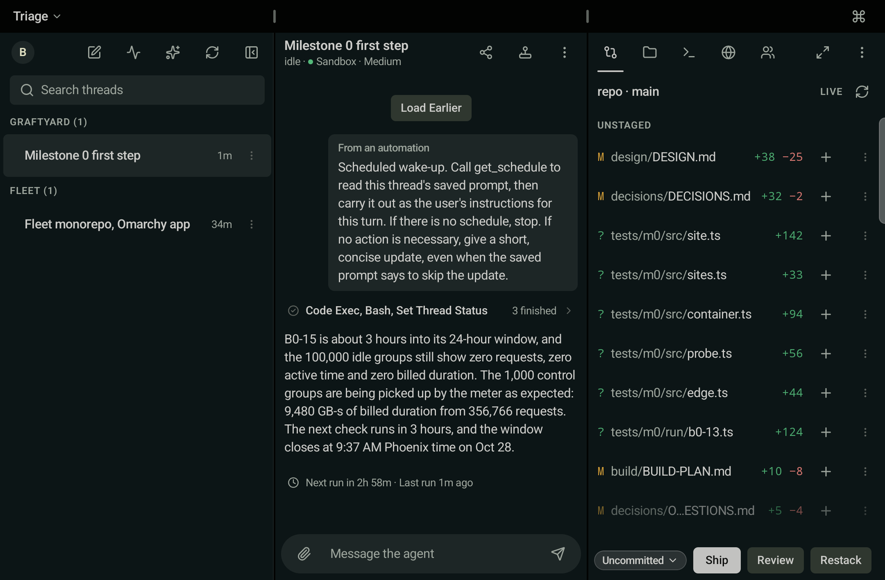

## Why use it instead of ampcode.com in a browser

The app speaks the same protocol as Amp's own clients, uses ampcode.com's colors and words, and adds what a phone and a foldable can do that a browser tab can't.

- **Three panes on the TriFold, with edges on the hinges.** The inner display shows the thread list, the transcript, and the thread's machine side by side: Changes, Files, Terminal, Portal, and Desktop. Pane edges snap to the two hinges, and sheets and menus open inside one panel, so no text sits on a fold.
- **An arrangement for each job.** Triage, Review, Terminal, Read, Puck, and Focus are one tap apart. Review gives the diff two panels and shows it side by side. Each window keeps its own arrangement.
- **Made for folding.** The cover screen shows one pane at a time with a bottom bar. The cover and the inner display each keep their own saved layout, and folding or unfolding resizes the window without restarting the app.
- **Notifications that Amp doesn't send.** Amp sends no push for a thread while any client has it open, so a forgotten ampcode.com tab silences your phone too (spike S23 in `spikes/protocol/RESULTS.md`). With **Notify even when a thread is open elsewhere**, on by default, the app checks for finished turns itself: every 3 minutes while a thread works, for up to 2 hours, though Android can delay a check while the phone sleeps. A turn never notifies twice, because the app's check and Amp's push both name the turn's last message, and whichever arrives second posts nothing.
- **Answer from the notification.** Reply to the agent from the shade without opening the app. An approval names the tool and the command. **Allow** appears only when the whole command fits in the notification. Otherwise **Review** opens the thread at the approval, so nobody allows a command they couldn't read. **Deny** is always there.
- **Push your way.** Notifications arrive through Firebase and your own relay, through UnifiedPush and ntfy on a phone without Google Play services, or through background checks with nothing set up at all.
- **A bad connection doesn't lose messages.** A message sent offline waits in an outbox, shows its state in the transcript, and sends when the connection returns. It keeps its message ID, so a resend never posts it twice. While you look at a thread, reconnecting never gives up.
- **Five accounts and many windows.** Keep up to five Amp accounts signed in, each with its own web profile. Open a thread, a machine pane, or a file in its own window, on the inner display or on a DeX monitor.
- **Keyboard and mouse.** Hardware keyboard shortcuts show in Android's shortcut helper, over DeX or Bluetooth. The terminal takes mouse selection, wheel scrolling, and right-click to copy or paste.
- **Attach from the phone.** Attach a screenshot of the app, a screen recording with or without the microphone, the latest recording on the device, or any file.
- **App Lock.** Turn it on, and the app asks for your biometrics or your device PIN before it shows anything.
- **Wakes orbs only when you look.** Opening a thread wakes its sleeping orb, as the web does. Background refresh, notifications, and replies from the shade never wake one, so the phone never starts billing an orb you aren't looking at.

## Screenshots

The TriFold screenshots show a release build on a Samsung Galaxy Z TriFold, signed in to a real account. The rest come from the TriFold emulator against the app's built-in fake server, `:fake-amp`.

| | |
|---|---|
| 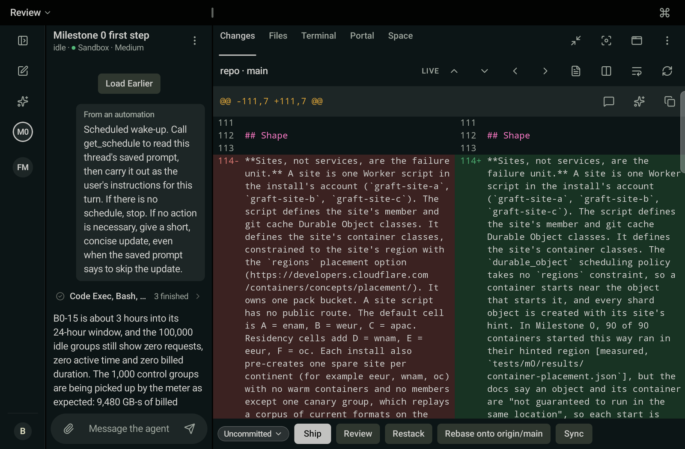 | 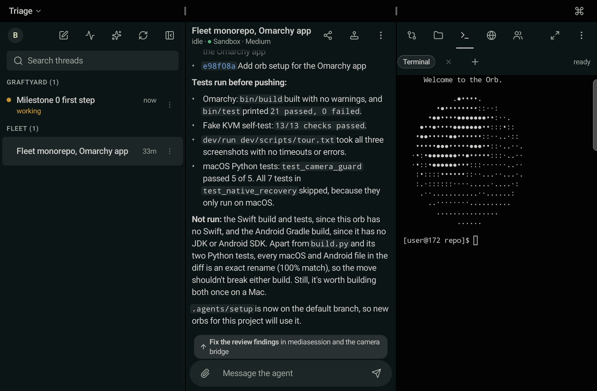 |
| **Review.** The diff takes two panels and reads side by side, with Ship, Review, Restack, Rebase, and Sync under it. | **Terminal.** A shell on the thread's orb, in a native terminal emulator, beside the transcript. |
| 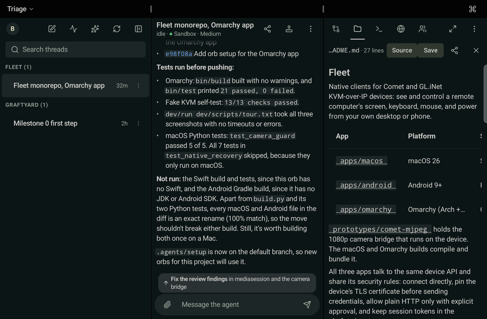 | 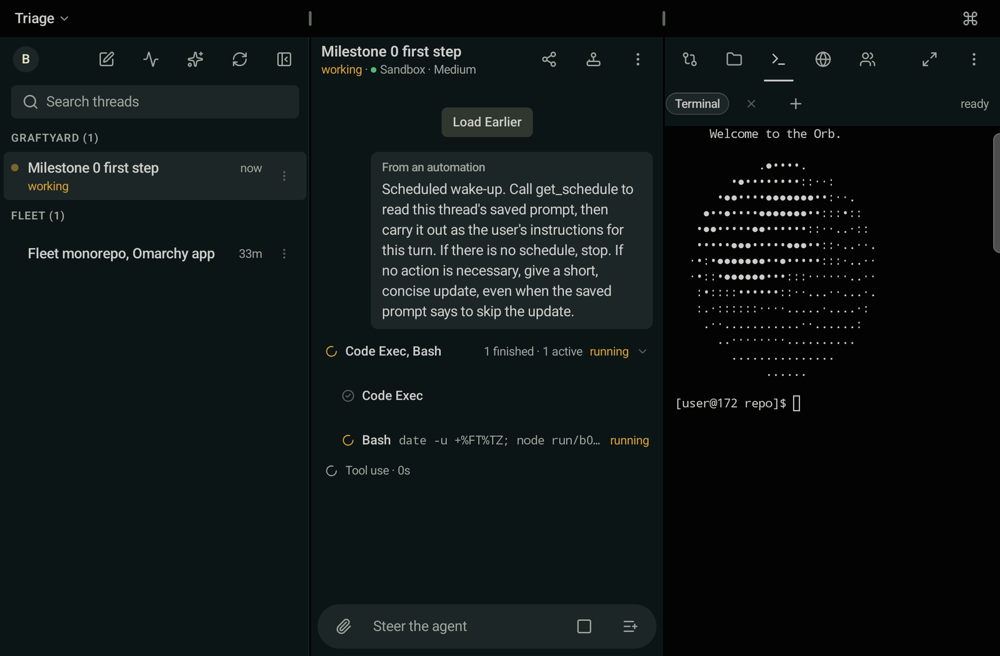 |
| **Files.** Browse the executor's checkout and read a file rendered or as source. | **Working.** Tool calls stream in as they run, and the composer turns into **Steer**. |
| 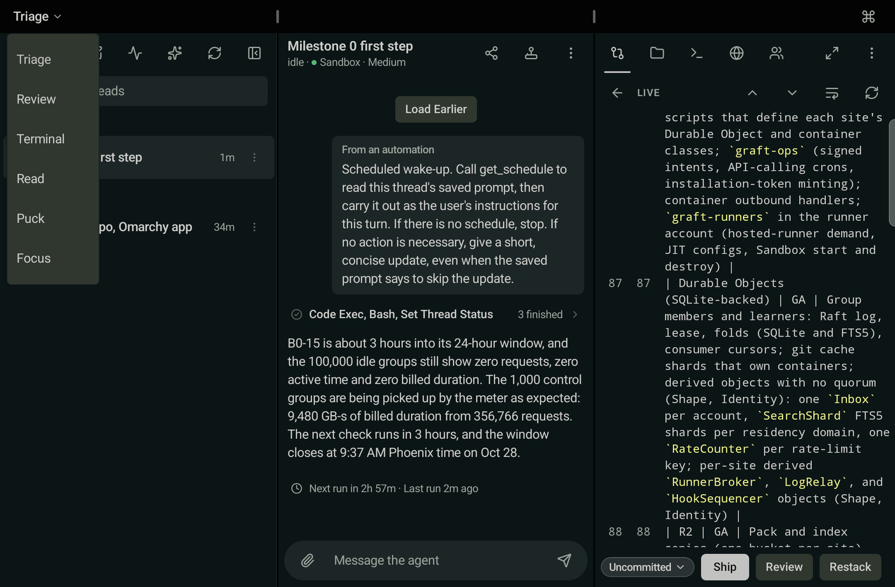 | 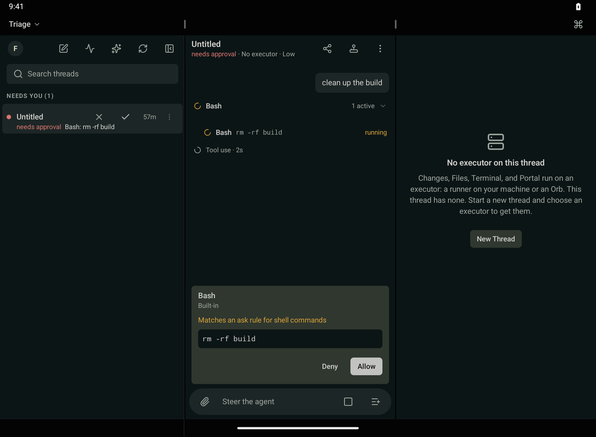 |
| **Arrangements.** Six layouts for the inner display, one tap apart. | **Approvals.** The agent's request waits in the thread with **Allow** and **Deny**. |
| 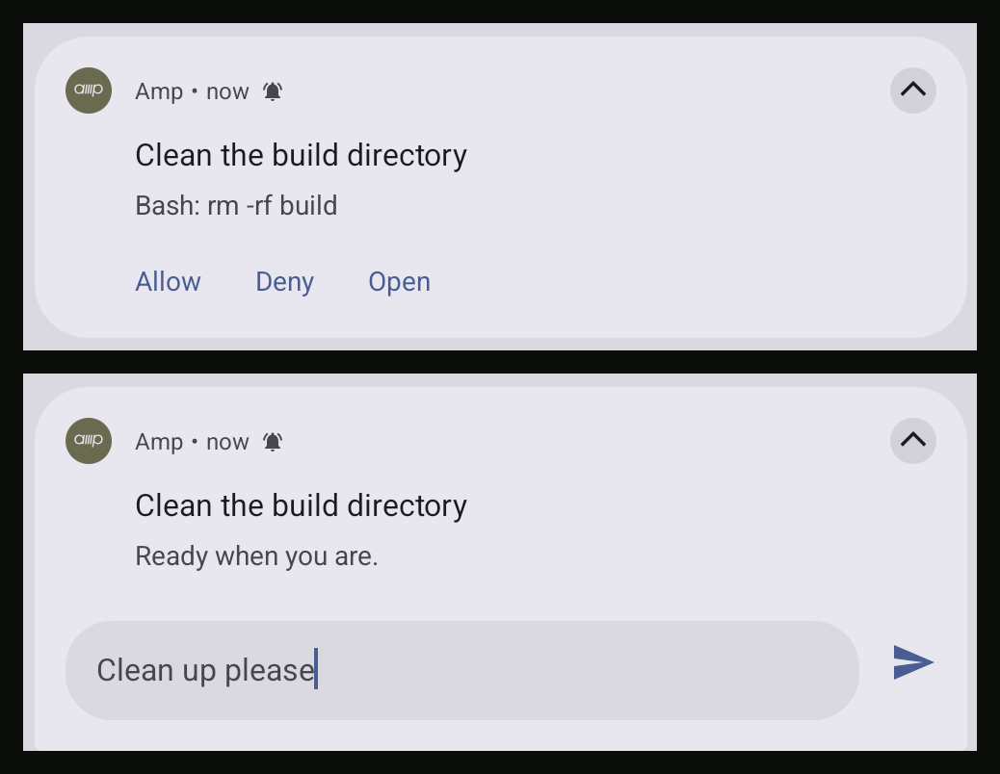 | 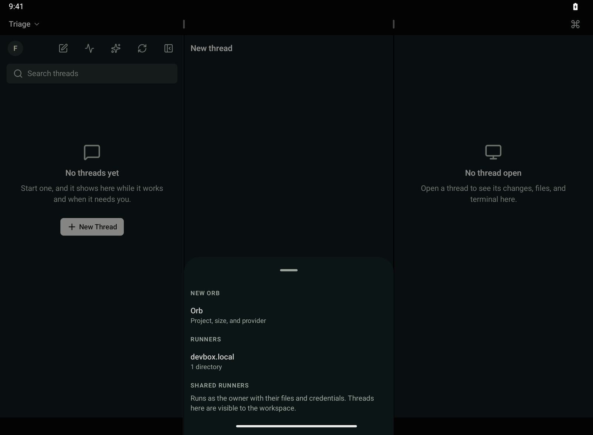 |
| **Notifications.** Allow, deny, or reply without opening the app. | **New thread.** Start work on a new orb, a self-hosted provider, or one of your runners. |
| 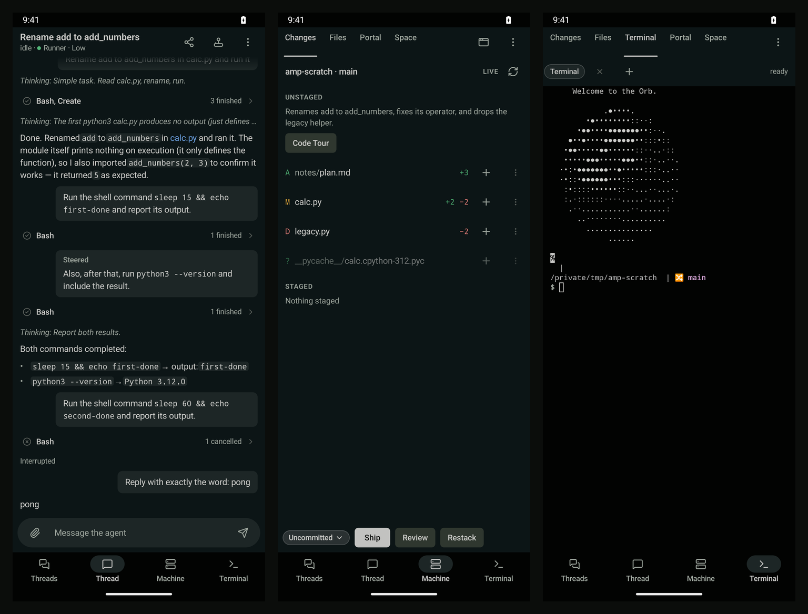 | 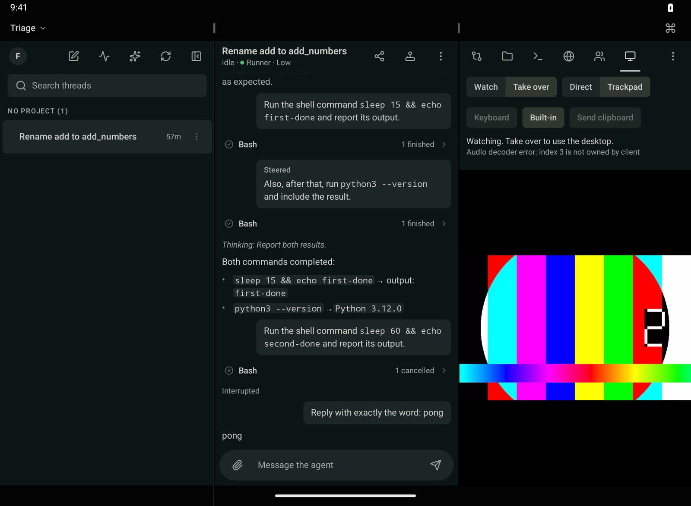 |
| **Cover screen.** One pane at a time with a bottom bar: Threads, Thread, Machine, and Terminal. | **Desktop.** Watch an executor's desktop next to the thread. |
| 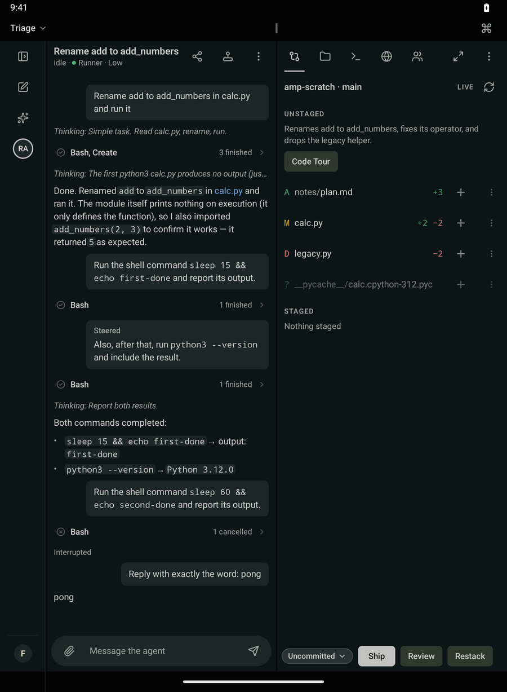 | |
| **Portrait.** The rail, the thread, and its changes side by side. | |

## Read this first

- This project is not affiliated with, endorsed by, or supported by Amp. "Amp" and the Amp logo belong to their owner. The app uses them only to name the service it connects to.
- The app talks to Amp through Amp's private, undocumented protocol: the same internal RPC, thread sockets, and relay the Amp CLI uses. Amp can change that protocol at any time without notice, and the app can stop working when it does.
- Signing in gives the app the same access to your Amp account as the Amp CLI. Agent turns spend your Amp credits.

`docs/protocol/` and `spikes/protocol/` hold the protocol notes: what the app relies on, and the spike scripts and captures that measured it.

## Modules

`settings.gradle.kts` includes these modules. `./gradlew checkModuleGraph` fails on any project dependency that `build-logic/convention/src/main/kotlin/com/agentifiers/amp/buildlogic/ModuleGraphRules.kt` does not allow.

| Module | Holds | May depend on |
|---|---|---|
| `:core:model` | Domain types, pure JVM | nothing |
| `:core:design` | Theme, Markdown and code rendering, test tags | `:core:model` |
| `:store` | The Room database, app settings, and saved window workspaces | `:core:model` |
| `:vt` | The Kotlin VT terminal emulator | nothing |
| `:sync` | The Amp protocol: HTTP, actor sockets, the outbox, engines | `:core:model`, `:store`, `:vt` |
| `:layout` | Arrangements, panes, and creases as data and functions | `:core:model` |
| `:waymote` | The desktop stream client | `:sync` |
| `:feature:fleet`, `:feature:thread`, `:feature:changes`, `:feature:files`, `:feature:space`, `:feature:puck`, `:feature:settings`, `:feature:web` | One pane or machine tab each | `:core:model`, `:core:design`, `:sync` |
| `:feature:terminal` | The Terminal tab | the feature set plus `:vt` |
| `:feature:desktop` | The Desktop tab | the feature set plus `:waymote` |
| `:notify` | Push, notifications, and Watch | `:core:model`, `:sync`, `:store` |
| `:app` | The window shell, Hilt wiring, and the debug app events | every module above |
| `:fake-amp` | A fake Amp server for tests and debug builds | nothing |

Only `:sync` tests and `:app` debug builds may depend on `:fake-amp`, so a release build never contains it. `relay/` is outside the Gradle build. It holds an optional push relay, a Cloudflare Worker.

## Set up your machine

You need JDK 17, the Android SDK, and `python3`. To run the flows you also need `agent-device` (version 0.21.16) on your `PATH`. Point Gradle at the SDK with `ANDROID_HOME` or with `sdk.dir` in `local.properties`. On macOS the SDK is usually at `$HOME/Library/Android/sdk`:

```sh
export ANDROID_HOME=$HOME/Library/Android/sdk
```

A fresh clone builds and runs with no extra files. The debug build talks to `:fake-amp` with no setup. Two optional local files add live features. Both are gitignored. Never commit them, and never paste their values into a doc, a flow, or a log.

### `local.properties`

| Key | What it does | When it is missing |
|---|---|---|
| `amp.rivetPublishableToken` | The Rivet publishable token embedded in the Amp CLI. The app opens thread sockets with it. `scripts/rivet-token.sh` copies it from the Amp CLI at `~/.amp/bin/amp`, or from `$AMP_CLI`, and never prints it. | The build succeeds, but no thread socket opens, against `:fake-amp` or live. |
| `amp.pushRelayUrl` | The base URL of your deployment of the push relay in `relay/`, for example `https://amp-push-relay.<your-subdomain>.workers.dev/`. It must start with `http://` or `https://` and end with `/`, or the build fails. The app registers each account's Web Push endpoint there, and the relay forwards Amp's pushes over FCM. | The app never uses a relay. It receives notifications through UnifiedPush when a distributor is installed, and otherwise by polling. |
| `amp.releaseSigning` | The path to a Java properties file with `storeFile`, `storePassword`, `keyAlias`, and `keyPassword`. The release build is signed with that key. | `assembleRelease` writes an unsigned `app-release-unsigned.apk`. |

### `app/google-services.json`

The Firebase config for your own Firebase project, with an Android app for the package `com.agentifiers.amp`. When the file exists, `notify/build.gradle.kts` reads its project id, sender id, app id, and API key into `BuildConfig`, and the app can receive pushes over FCM from your relay. Without it, the build still succeeds, and the app uses UnifiedPush or polling. FCM delivery needs both this file and `amp.pushRelayUrl`.

### The push relay

The relay is optional. It turns Amp's Web Push into FCM messages for one Firebase project. `relay/README.md` shows how to create its D1 database, set its secrets, and deploy it with `wrangler`. `docs/design/push-relay.md` is its design.

## Build

```sh
./gradlew assembleDebug assembleRelease test checkModuleGraph
```

The debug APK is `app/build/outputs/apk/debug/app-debug.apk`. It carries `:fake-amp` and the debug app events. The release APK carries neither. `test` also runs `scripts/dp-budget.sh` and the source bans described in [Change the UI](#change-the-ui).

To run one module's JVM tests, run `./gradlew :<module>:test`, for example `./gradlew :fake-amp:test`.

## Run the app on an emulator

Do not run `./gradlew installDebug` or any other Gradle install task when more than one device is attached. Gradle installs on every attached device. Install with `adb -s <serial>` instead.

1. Create the TriFold AVD once. It is 2160 x 1584 at 320 dpi (1080 x 792dp), landscape, Android 16:

   ```sh
   scripts/create-trifold-avd.sh
   ```

2. Start an emulator slot. Slots 1 to 13 can run at once. Slot N listens on port `5554 + 2 * N`, and the script prints the serial after boot, for example `emulator-5556` for slot 1:

   ```sh
   serial=$(scripts/emu.sh start 1)
   ```

3. Install the debug APK. `scripts/emu.sh` boots the AVD read-only, so a cold boot forgets the app. Install after every start:

   ```sh
   adb -s "$serial" install -r app/build/outputs/apk/debug/app-debug.apk
   ```

4. Stop the emulator when you are done:

   ```sh
   scripts/emu.sh stop 1
   ```

## Run the flows

Flows are agent-device scripts in `flows/`. Each one signs in to a `:fake-amp` scenario through debug app events and asserts on test tags. Install the debug APK first, because `scripts/flows.sh` does not install it.

```sh
scripts/flows.sh "$serial"
scripts/flows.sh "$serial" 'flows/gate-*.ad'
```

`scripts/flows.sh <serial> [glob-or-path...]` runs `flows/*.ad` unless you give globs or paths. Before the run it waits for boot, closes "isn't responding" dialogs, closes system pickers that a failed run left open, sets the device's animation scales to 0 (and puts them back when it exits), and seeds the picker fixtures with `scripts/seed-fixtures.sh`. It writes the JUnit report to `build/flows/junit.xml` and one artifacts directory per flow attempt under `build/flows/`. `flows/README.md` explains how to write a flow and the limits of the `.ad` language.

`scripts/flows.sh` refuses to run when the device's font scale is not 1.0, because the flows' swipes and waits are written for the default text size. To reset it, run `adb -s <serial> shell settings put system font_scale 1.0`.

`flows/settings-app-lock.ad` needs a fingerprint enrolled on the emulator. `flows/e2e-day.ad` is the cross-feature flow. On one sign-in to the `e2e-day` scenario it reads tool cards, answers a gate, comments on a hunk, runs `pwd` in the terminal, sends an image, opens a thread from a notification, archives a thread, switches arrangement, and signs out.

### Protect devices you do not want to touch

Every script that drives a device (`scripts/flows.sh`, `scripts/seed-fixtures.sh`, `scripts/sign-in-live.sh`, `scripts/ux-shots.sh`, and `scripts/check-alignment.sh`) takes an explicit serial and first calls `guard_device` from `scripts/device-guard.sh`. To make the scripts refuse a device, list its serials in `AMP_PROTECTED_SERIALS`, separated by spaces. The guard compares each entry with both the adb serial and the device's hardware serial (`ro.serialno`), so a wireless `ip:port` serial is refused too:

```sh
export AMP_PROTECTED_SERIALS="<your-phone-serial> <another-serial>"
```

## Pick a fake-amp scenario

`:fake-amp` serves one scenario per server. A flow picks its scenario with the `use-server` event, then signs in with any token:

```
trigger-app-event use-server {"scenario":"approvals"}
trigger-app-event sign-in-token {"token":"fake-amp-accepts-any-bearer"}
```

`use-server` signs out every account on another server, so one sign-in sees one scenario. `flows/slice1-sidebar.ad`, `flows/layout-divider-snap.ad`, and `flows/layout-window-bar.ad` read `${AMP_SCENARIO:-fleet-basic}`, and `AMP_SCENARIO=<name> scripts/flows.sh "$serial"` changes their scenario.

The scenarios are listed in `fake-amp/src/main/kotlin/com/agentifiers/amp/fake/scenarios/Registry.kt`. Many of them replay the captures in `spikes/protocol/captures/`. To run a scenario on your computer for an emulator to reach at `http://10.0.2.2:<port>`, run `./gradlew :fake-amp:run --args='<scenario> <port>'`.

## Send debug events

Debug builds handle `amp-debug://event/<name>?json=<urlencoded JSON>`. Inside a flow, use `trigger-app-event`. From a shell, send the deep link with adb, and read the result under the log tag `AmpEvent`:

```sh
adb -s "$serial" shell am start -W -a android.intent.action.VIEW -d "'amp-debug://event/open-catalog?json=%7B%7D'"
adb -s "$serial" logcat -s AmpEvent
```

The "Debug app events" table in `docs/design/verification.md` lists every event with its payload and effect.

## Sign in live

To use the app with your Amp account, install it and sign in from the sign-in screen. The device code is the default method.

For the live flows, `scripts/sign-in-live.sh <serial>` signs the debug app in with an Amp API key. It reads the key from `AMP_API_KEY`, or from the Amp CLI's stored key for the server in `AMP_URL` (default `https://ampcode.com`). It sends `use-server` and `sign-in-token` with adb, so the key never reaches stdout, a flow file, or agent-device's logs. Never put a real token in a flow or pass one to agent-device, which writes event URLs to its own logs. Then run the read-only live flows:

```sh
scripts/sign-in-live.sh "$serial"
scripts/flows.sh "$serial" 'flows/live/*.ad'
```

A live agent turn spends credits, and creating or waking an orb bills the account.

The release build and the debug build are signed with different keys, so Android refuses to install one over the other (`INSTALL_FAILED_UPDATE_INCOMPATIBLE`). To switch between them, uninstall the app first, which deletes its data. The release build has no debug events, so sign in from the sign-in screen.

## Change the UI

The app has one look and one set of controls. Keep to them, and check each change with a screenshot before and after.

**Colors come from one token table.** `AmpTheme.colors` reads `Forest` in `core/design/src/main/kotlin/com/agentifiers/amp/design/theme/Forest.kt`, and `AmpPalette.kt` there defines the groups: surfaces, text, accents, status, code, thread colors, media, and debug. `docs/design/brand.md` gives every value and its source on ampcode.com. The `ampSourceBans` task runs before each module compiles. It fails on `Color(0x…)`, `Color(<number>)`, `Color.Red` and the other named colors, and any `0xFF……` literal outside that `theme/` folder, tests, and resource files. To add a color, add a token to `AmpPalette.kt` and its value to `Forest.kt`. `PaletteContrastTest` checks the WCAG ratios of the palette.

**Controls and icons come from `:core:design`.** Use `AmpButton` in its ranks, `AmpIconButton`, `AmpChip`, `AmpPaneHeader`, `AmpListRow`, `AmpSectionLabel`, `AmpSearchField`, `AmpTabRow`, `AmpInputBar`, and `AmpEmptyState`, and draw icons from `AmpIcons`. `ampSourceBans` also fails when a module outside `:core:design` imports or names a Material3 button, such as `Button`, `TextButton`, `OutlinedButton`, `IconButton`, or `ButtonDefaults`. Debug builds show every control in a catalog that the `open-catalog` event opens.

**Text styles and sizes come from the density tables.** Every text style is a role in `AmpTheme.type`, picked by what the text is: `rowTitle` for a row's title, `meta` for its age, `section` for a group heading. Component sizes are in `AmpTheme.metrics`, gaps in `AmpTheme.spacing`, corners in `AmpTheme.shapes`, and each pane's ground in `AmpTheme.surfaceRoles`. `docs/design/brand.md` lists them under "Type and sizes". `ampSourceBans` fails on an `N.sp` literal, `fontSize =`, `lineHeight =`, `letterSpacing =`, `TextStyle(`, or `MaterialTheme.typography` outside the `theme/` folder and tests. `scripts/prove-type-bans.sh` plants each one and shows the failure. `./gradlew test` runs `scripts/dp-budget.sh`, which fails when raw `N.dp` literals in `feature/` and `app/` exceed the budget in `scripts/dp-budget.txt`. When you replace literals with tokens, lower the budget to the new count. `scripts/check-alignment.sh <serial>` checks on an emulator that every pane header has the same top and bottom in each arrangement and that the window bar is 40dp.

**Two scripts generate icon code. Never edit their output by hand.**

- `python3 scripts/make-icons.py` writes the launcher icon, the splash icon, the notification icon, and the store PNG from `docs/design/brand/ampcode-app-icon.svg`. The PNG needs `rsvg-convert` (`brew install librsvg`).
- `python3 scripts/make-icons-lucide.py` writes `AmpIcons.kt` and `core/design/LICENSES.md` from the pinned `lucide-static` release. To add an icon, add its Lucide name to `ICONS` in the script, rerun it, and raise the icon count in `AmpIconsTest`.

A rerun of either script with no change writes identical files, so `git status` stays clean.

**Capture every surface with `scripts/ux-shots.sh`.** With the debug APK installed on an emulator, `scripts/ux-shots.sh [--font-scale <x>] <serial> <outdir>` runs the capture flows in `flows/ux/` and writes one PNG per surface. Each phase changes one device setting (shade, keyboard, font scale, portrait, or cover) and restores it. `--font-scale` applies to every phase and is restored afterwards. The script exits non-zero when a flow fails or a shot is missing.

## Find the docs

- `docs/design/` is the design. Start at `docs/design/README.md`. `docs/design/roadmap.md` has the milestones, their gates, and the status of each.
- `docs/protocol/private-protocol.md` maps the private protocol from the Amp CLI and the web app. `spikes/protocol/README.md` explains how to rerun the protocol spikes against your own account, and `spikes/protocol/RESULTS.md` records what they measured.
- `python3 scripts/check-docs.py` checks `docs/design/` for missing paths, missing anchors, and dash characters.
- `CHANGELOG.md` lists each release.

## License

MIT. See `LICENSE`. The icons in `AmpIcons.kt` come from Lucide under the ISC license, with some derived from Feather under the MIT license. `core/design/LICENSES.md` has both texts.
