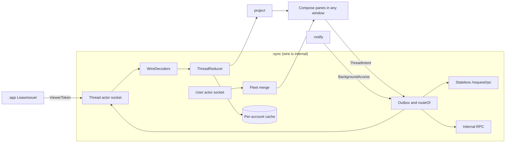

# Architecture

This document explains the shape of the app and why it has that shape. The type-level design is in `sketch/`: `sketch/README.md` has the module map and where each decision lives, `sketch/RATIONALE.md` has the full argument, and `sketch/COVERAGE.md` maps every capability to a module and type. Where the prose docs and the sketch disagree, the docs win and the sketch is fixed to match. Citations into the sketch name a file and a type, not a line, because the sketch keeps changing.

## Native first, on the CLI's protocol

Every Amp surface the app draws is Jetpack Compose. The app talks to Amp through the same private protocol the Amp CLI uses, with the same personal credential, because that is the only write path a third-party client has:

- The public External API v2 can list and read threads but cannot create one or send a message, and user sign-in for third-party apps is not generally available (Amp's public OpenAPI description `info.description`).
- ampcode.com's own settings screens run on SvelteKit remote functions whose ids change with each web deploy (`docs/protocol/private-protocol.md:329`).
- The CLI's calls stay stable because CLIs already installed on users' machines must keep working (`docs/protocol/private-protocol.md:12-22`).

Two live spikes exercised that protocol against ampcode.com. Thread lists, live threads, sending, steering, interrupting, git, the terminal, transcript paging, thread operations, attachments, plugin dialogs, file access, the user actor, and Web Push all worked. Rows S1 to S20 of `spikes/protocol/RESULTS.md` are the only source of verdicts in these docs.

Web views appear only for content that is web by nature: portal pages, MCP App UIs, `amp-view` prototypes, account, billing, and workspace pages, and the **Open on web** and **Answer on web** fallbacks, which open in the account's own WebView profile (`auth-and-security.md:203-209`). A build rule fails on the literal `/_app/remote/` anywhere outside `:feature:web`, and native code never calls it. Two native calls use the `web-plain` tier, voice transcription and the Space call token. Neither is part of the core loop, and both have fallbacks: dictation falls back to the on-device `SpeechRecognizer`, and Space opens on the web.

We chose this over the approach Amp's own Apple apps take, which load ampcode.com in a web view and replace parts of it natively (Amp's docs). An Android shell would have to impersonate the iOS bridge dialect with payloads nobody has recorded, and its transcript would be web content that agent-device cannot select (`sketch/RATIONALE.md`, section "What it deliberately does not do").

## One engine per account

The `:sync` module owns everything that touches the network: sockets, tokens, push keys, caches, the outbox, and push upkeep. Its public surface is small:

- `AccountScope` is one signed-in account.
- `ThreadHandle` is one thread. Screens collect `ThreadState` from it and send `ThreadIntent`s to it.
- `Fleet` is the sidebar's view of every thread.
- `Machine` is the executor behind a thread: Changes, Files, Terminal, Desktop, and Portals. It owns the terminal sessions, described under [One socket per visible thread](#one-socket-per-visible-thread).
- `BackgroundAccess` is what notification code gets, from `BackgroundAccessProvider.forAccount(account)`. It can read and answer through a short-lived socket but cannot hold one open. `AccountScope` has no path to it.
- `AuthenticatedImageLoader` loads attachment images with the account's Bearer token. A 401 triggers the same refresh as any other request.

### Wire formats live in `:sync`

Every Amp wire type is Kotlin `internal` to `:sync`, so no other module can import a protocol DTO. That covers three formats that are easy to put elsewhere:

- The Web Push payload. `BackgroundAccess.decodePush` turns the decrypted JSON into a `PushEvent`, and `:notify` only displays it.
- The token a notification action carries for a gate answer. `GateTokens` in `:sync` encodes and decodes it, and `:core:model` holds only the domain `GateResponse`.
- The outbox's stored commands. `:sync`'s `OutboxCodec` writes each command as versioned JSON, because the `:core:model` command types carry no serialization annotations.

When Amp changes the thread actor, user actor, RPC, or push protocol, the change lands in `:sync`. `:waymote` is the one other module that speaks a wire format, by design: it decodes the `amp-desktop-v1` stream for the Desktop tab, which is a later release (`sketch/settings.gradle.kts`).

### Credentials have one owner

`:sync` is the only module that reads or writes tokens and push keys. Its internal `TokenVault` keeps two entries per account, `TokenEntry` for the access and refresh tokens and `PushKeys` for the push key alias and auth secret, and each has its own compare-and-set, so a token refresh can never write back stale push keys (`auth-and-security.md:118-133`). `:notify` hands a push body to `BackgroundAccess.decodePush`, and `:app` loads images through `AuthenticatedImageLoader`. Neither touches the vault.

## Hilt composes the modules

Android creates workers, broadcast receivers, and services itself, so they cannot receive the engine through a constructor. The app uses Hilt:

- `:app` builds the engine with `AmpEngines.create(...)`, which returns `EngineParts(engines, leases, background)`. Hilt binds `AmpEngines` and `BackgroundAccessProvider`, which yields one account's `BackgroundAccess`. `:app` keeps `leases`, the `LeaseIssuer`, in a private field and never binds it, so no other module can obtain one.
- `:notify`'s workers, receivers, and watch service reach the engine through `NotifyEntryPoint`, which exposes only `BackgroundAccessProvider`.
- A pane receives the `AccountScope`, which has no `background` property, so a pane cannot reach `BackgroundAccess`.
- `:store` provides one Room database per account file, `amp-<accountId>.db`, opened once per process and shared by `:sync` and `:notify`. It provides one DataStore file per proto type, because Proto DataStore holds one type per file.

Each window carries its own account. The window state and the saved workspace record the account, and entry routing for a notification, deep link, or share opens the thread in a window for that account.

### No row is larger than 1 MiB

Android reads a SQLite row through a 2 MB `CursorWindow`, and a read of a larger row throws `SQLiteBlobTooBigException`. Every table whose rows can grow with what the server or the user sends caps a row at `MAX_CACHED_ROW_BYTES`, 1 MiB of UTF-8, and its reads never fetch a larger row that an older build left on disk:

- `change_snapshot` and `file_order` skip a larger write. A read deletes the scope's larger rows first, so the pane paints with no cache.
- `outbox` never stores a larger command. `CommandQueue` shows it at once as rejected with "Too large to send. Keep it under 1 MB." A read blanks a larger stored command, so the codec reads it as a command from an older version, which the user can discard.
- `comment_draft` needs no cap, because `addComment` caps the pending comments of a thread at 10 KiB together.

`message_row`, `sequenced_row`, `snapshot_row`, `thread_summary`, `catalog`, `draft`, and `blob` have no reader or writer yet. `blob` already skips a blob over 1 MiB, and whoever wires one of the others applies the same cap. The notification tables hold ids and timestamps only.

A SQLite failure never ends the process. The engine scopes carry `StorageFailureHandler`, which logs a `SQLiteException` and passes any other failure on to the thread's uncaught exception handler. The Changes cache and the outbox read through `readOrAbsent`, so an unreadable row reads as no row.

### Sign-out has one coordinator

`SignOutCoordinator` in `:app` runs sign-out, because `:app` is the only module that reaches everything an account leaves behind. It calls `:sync` for sockets, the outbox, tokens, push keys, the relay registration, and the Room database, `:notify`'s `AccountTeardown` for WorkManager work, posted notifications, and a UnifiedPush instance when the device uses one, `:feature:web`'s `WebProfiles` for the account's WebView profile, and the image cache. The order of the steps and the text the user sees are in `auth-and-security.md:163-179`.

## Thread state is a fold of the actor's events

A thread actor sends events and never a full snapshot, so every client builds its own state by folding events (`docs/protocol/private-protocol.md:110-115`). The app folds them in a pure `ThreadReducer`. Each event has one of four fact classes, taken from what the captures showed:

| Class | Examples | Rule |
|---|---|---|
| Sequenced | `message_added`, `queued_message_*`, `cancelled`, `error_set` | Upserts its row by key, and the cursor becomes the highest `seq` seen. Rows and cursor are written in one transaction. |
| Snapshot | `tool_approval_queue`, `queued_messages`, title, settings | Replaces one aspect of the state. |
| Keyed | `plugin.ui.request_added`, `plugin.ui.request_settled`, `plugin.ui.request_removed` | Upserts, settles, or removes one entry by id. `request_removed` also cancels the dialog's notification. Never cached, because the server lists pending dialogs again on every reconnect. `request_removed` is read, not observed (Amp's docs). |
| Volatile | `delta`, `agent_state`, `tool_progress` | Memory only. Dropped when the connection ends. |

`plugin.ui.snapshot` is a Snapshot frame that lists every pending dialog, but the app never caches it either (`sketch/sync/internal/Facts.kt`, `PluginUi`).

Resume is idempotent. After loading paged history, the app resumes from `thread.data.v`, so the socket replays nothing it already has (`RESULTS.md` row S17). A sequenced event upserts its row by key, so applying it twice equals applying it once. The reducer does not drop events at or below the cursor, because the connect burst re-sends `error_set{seq:9}` when resuming at version 9 (`spikes/protocol/captures/s17-resume-cursor.jsonl:157`). A property test feeds each recorded session in the order the server sends it, history replay first and then the current-state burst (`s17-resume-cursor.jsonl:10-44`, then `:45-70`). It splits the session at every frame, resumes, and checks that the result is identical to an unbroken replay.

`ThreadState` merges four things at read time: the fold, the connection state, the user's local draft and outbox, and the streaming overlay. Each has one owner, so two windows on the same thread never disagree.

## One socket per visible thread

Opening an orb thread's machine can wake the orb and bill the user (Amp's docs). Whether connecting the thread socket alone wakes a paused orb is unmeasured. Every path to a thread socket therefore goes through the lease issuer and these rules:

- **Only a lease holds a socket open.** `LeaseIssuer` issues `ViewerToken`s, and only `:app` holds it. `VisibleThreadLeases` in `:app` takes a lease for each thread a window shows, holds it while the window's lifecycle is `STARTED`, and releases it on `ON_STOP`. Leases do not follow the Compose composition, which outlives `onStop`. A JVM test drives a window's lifecycle to `ON_STOP` and checks that every lease it held is released.
- **Only a shown thread wakes a sleeping orb.** When a leased thread's socket reports a sleeping orb, `ThreadEngine` sends the web's wake, `client_spawn_executor{executorDemand:"optional"}`, once per sleep, shared by every pane and window on the thread (`screens.md`, "Wake an orb only for a shown thread"). `BackgroundAccess` cannot send it.
- **A socket closes after a grace period.** A thread socket closes 30 seconds after its last lease is released. It stays open while any relay channel on it is open. A terminal channel closes 60 seconds after its last viewer, a Terminal pane or a live terminal card in a started window, goes away, so a backgrounded terminal holds its socket for about 60 seconds.
- **Reconnect never stops while a viewer is present.** While a lease is held and the network is up, `:sync` keeps retrying with backoff and shows **Retry Now** (`transport.md:289`).
- **Background code borrows a socket and never holds one.** `BackgroundAccess` runs each answer or push subscription through `LinkSupervisor.onSocket`, which uses the thread's one socket when it is open and opens a short socket only when none is. A short socket resumes from the cached cursor. For a thread with no cache it resumes from the `threadVersion` that `POST /api/thread-actors` returns (`WsGrant.threadVersion`), folds in memory, and writes nothing to the cache, so it replays no history (`transport.md:275`). `BackgroundAccess.leasedThreads` tells `:notify` which threads a started window shows.

Two panes or two windows on the same thread share one socket, one fold, and one `StateFlow`. `Machine` owns one terminal session per session key, shared by every window that shows it, so a second window joins the same screen state instead of a byte stream in mid-sequence. Tab 1, the thread's default terminal, has no session key (`terminal.md:197`).

## Writes go through an outbox with delivery classes

A write that can wait for a connection is a `Command` with a delivery class. The outbox stores it and drains it when its route is up:

- **Replayable.** Safe to resend. A send carries a client-minted `messageId`, and the server deduplicates a resend (`RESULTS.md` row S16). A send is acknowledged by `queued_message_added` or `message_added` carrying its `messageId`, whichever arrives first. A steer waits in the queue until the next tool boundary, and its `queued_message_added` already carries the client id (`s05-steer-interrupt.jsonl:56`), so the outbox stops resending once the steer is queued. `EditMessage` mints an `editId`, so a resent edit names the same edit.
- **AtMostOnce.** Never resent automatically. A file write and an interrupt are examples. If the acknowledgment is lost, the UI shows the outcome as unknown. Interrupt is its own command, `client_cancel` over the thread socket, because `/request/rpc` rejects it (`RESULTS.md` row S18). **Interrupt and send** is two commands, `Interrupt` and then a separate `Send`, so a resent send never cancels the turn it started.
- **Guarded.** Dropped if its condition stops holding. An approval answer is dropped if the approval is no longer pending. The drainer evaluates the guard after `client_resume` finishes on the socket that will carry the command, so it never checks a stale fold. Plugin dialogs are never cached, so a check before resume would drop a valid answer.
- **Ephemeral.** Memory only, for secrets. `Command.Durable` is the parent of the three classes above, and `OutboxCodec.encode` accepts only `Command.Durable`, so an `Ephemeral` command cannot be written to an `OutboxRow`. `EphemeralSender` delivers it instead (`sketch/sync/internal/Routing.kt`). Setting a secret (`SetSecret`) and answering a secret plugin input are `Ephemeral`. If the process dies before delivery, the value is gone and the user enters it again.

Interactive requests that need an answer now are not commands. Staging in Changes (`Changes.stage`), uploading a file (`Files.upload`), and starting a thread (`AccountScope.startThread`) are direct calls. Each requires a live connection, fails at once without one, and is never queued. Reads are direct calls too.

`routeOf` picks the path for each command with an exhaustive `when`, so a new command without a route fails to compile. The stateless `/request/rpc` path accepts only `client_append_user_msg` (`RESULTS.md` row S18), so it carries quick replies from notifications and nothing else. Everything else goes over the thread socket, internal RPC, or a user actor action.

## Extensions register in one place

Each extension point is one closed list in one module, checked by the compiler or by a unit test:

- **Panes and machine tabs.** `PaneDestination` and `MachineTab` are sealed, and `:app` renders them with an exhaustive `when`. A new destination without a branch fails to compile.
- **Tool cards.** One `ToolCards` map in `:feature:thread` maps a tool name to its card. Unknown tools render with `GenericToolCard`.
- **Wire decoders.** One `WireDecoders` map in `:sync` maps an event type to its decoder. Unknown events are counted and shown as a degraded-connection banner.

Each map is built from a list of pairs, and a unit test, `ToolCardsTest` or `WireDecodersTest`, fails when two pairs share a key. There is no annotation processor and no code-generation module. Human gates the app cannot decode become `UnsupportedGate` with **Answer on web**.

## Layout is a pure function

`planLayout` takes the window size, the creases, the windowing mode, and the user's chosen arrangement, and returns columns with panel spans and divider snap points. It has no Android dependency, so tests cover every form factor without a device. Only machine panes may span a crease. The behavior is specified in `layout.md`.

## Module boundaries are checked by the build

`build-logic/ModuleGraphRules.kt` lists every allowed module edge, including test-only edges such as `:sync` on `:fake-amp`, and every banned import. `checkModuleGraph` fails the build on any other edge. WebView and Custom Tabs code is allowed only in `:feature:web`.

| Module | Owns |
|---|---|
| `:core:model` | Domain types: ids, `ThreadState` and its sum types, gates, commands and their delivery classes, panes. No wire formats. |
| `:core:design` | Theme, `AmpTag` test tags, Markdown and code rendering |
| `:sync` | The engine, every Amp wire format, `TokenVault`, `OutboxCodec`, `GateTokens`, `WireDecoders`, `AuthenticatedImageLoader`, `PushRelayClient`, and `TerminalSession`, which owns the `:vt` screen model a terminal shares across windows |
| `:store` | One Room database per account file and one DataStore file per proto type, provided through Hilt. No credentials. |
| `:layout` | Window geometry, creases, arrangements, `planLayout` |
| `:vt` | The terminal parser and screen model (`terminal.md`) |
| `:waymote` | The desktop stream client, which speaks `amp-desktop-v1` (later release) |
| `:feature:fleet` | Sidebar, Activity, new-thread sheet |
| `:feature:thread` | Thread pane, transcript, `ToolCards`, gates, composer |
| `:feature:changes`, `:feature:files`, `:feature:terminal`, `:feature:desktop`, `:feature:space` | One machine tab each |
| `:feature:puck` | Puck pane and its entry points |
| `:feature:settings` | Accounts and native settings |
| `:feature:web` | Every WebView and Custom Tab, and each account's WebView profile |
| `:notify` | Push display, `RelayMessagingService` for FCM and the UnifiedPush receiver, watch, polling, notification actions. Reaches the engine only through `NotifyEntryPoint`. |
| `:fake-amp` | Fake server for tests and debug builds |
| `:app` | Composition root with Hilt, windows, `LeaseIssuer` and `VisibleThreadLeases`, the pane and machine-tab `when`, `SignOutCoordinator`, debug app events |

Outside the Gradle build, `relay/` holds the push relay, a Cloudflare Worker with its own tests and deployment (`push-relay.md`).

## What the design does not do

- It does not run the agent, its tools, plugins, or MCP servers on the phone.
- It does not call SvelteKit remote functions or scrape their hashes.
- It does not embed the ampcode.com thread page.
- It does not keep a socket open for a thread nobody is looking at, except during an opt-in watch, which holds only the user actor socket.
- It does not write a secret to disk. Secrets travel as `Ephemeral` commands.

## Open questions

- The tool approval wire format is read from the web bundle and not yet observed. Spike row S15 has the rerun command. Until it runs, the M4 gate uses the plugin dialog flow from S15b (`roadmap.md:15`).
- How many folding features does the physical TriFold report, and where?
