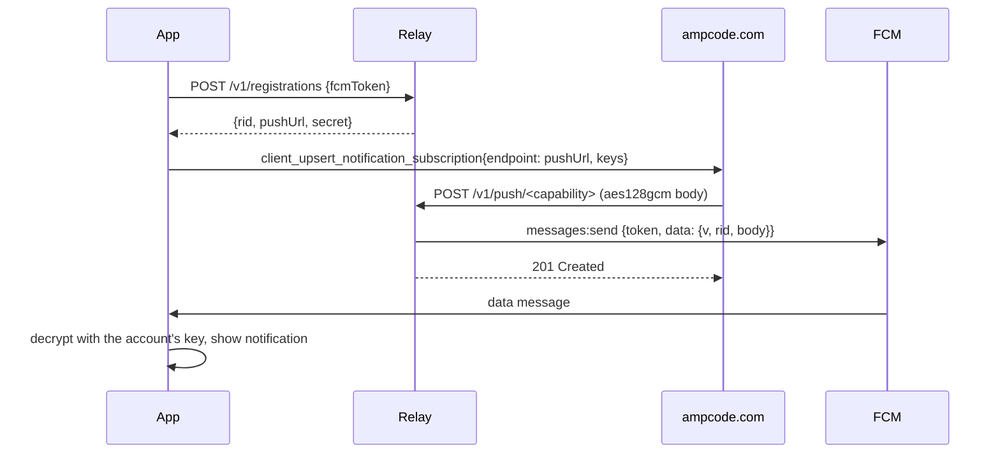

# Push relay

The push relay is a Cloudflare Worker that turns Amp's Web Push into Firebase Cloud Messaging (FCM) for the Android app. It exists because Amp only sends Web Push to a URL (`spikes/protocol/RESULTS.md` row S11), Android only wakes a stopped app reliably through FCM, and only we hold the credentials to send FCM to this app. `notifications.md` explains how the app uses it.

The relay forwards ciphertext. Amp encrypts every push to a key pair that only the app holds (RFC 8291), so the relay never sees thread titles, message text, or anything else in the payload.



## Data

The relay stores one row per registration in Cloudflare D1. With read replication off, which is the default, D1 reads go to the primary database, so a registration is visible to the push handler as soon as the app gets its push URL. Workers KV would be cheaper, but a new key can take up to 60 seconds to appear in other locations, and Amp's first push could arrive in that window and get `410 Gone`.

```sql
CREATE TABLE registrations (
	rid TEXT PRIMARY KEY,          -- base64url(SHA-256(capability)), safe to log and to send to the app
	fcm_token TEXT NOT NULL,
	secret_hash TEXT NOT NULL,     -- base64url(SHA-256(secret)); the secret itself is never stored
	created_at INTEGER NOT NULL,
	updated_at INTEGER NOT NULL,
	last_push_at INTEGER
);
```

- The **capability** is 32 random bytes, base64url. It appears only in the push URL, `https://<relay-host>/v1/push/<capability>`, which the app gives to Amp. Anyone with the URL can post to it, so the relay stores only its hash.
- The **rid** is the hash of the capability. The app computes the same hash, so it can match an incoming FCM message to an account without the relay sending the capability back.
- The **secret** is 32 random bytes the app uses to update or delete its registration. The app stores it in the account's vault entry in `:sync`, next to the push keys (`auth-and-security.md`).

One device has one FCM token and one registration per signed-in account. Five accounts on one phone means five rows with the same `fcm_token`.

## API

All bodies are JSON except the push body.

| Method and path | Caller | Auth | Request | Responses |
|---|---|---|---|---|
| `POST /v1/registrations` | App | Rate limit per IP | `{fcmToken}` | `201 {rid, pushUrl, secret}`, `400`, `429` |
| `PUT /v1/registrations/{rid}` | App, when FCM rotates the token | `Authorization: Bearer <secret>` | `{fcmToken}` | `204`, `401`, `404` |
| `DELETE /v1/registrations/{rid}` | App, at sign-out | `Authorization: Bearer <secret>` | none | `204`, `401`, `404` |
| `POST /v1/push/{capability}` | Amp | Capability URL, VAPID check when configured | `aes128gcm` body, Web Push headers | See below |

### The push handler

1. Reject a body over 4096 bytes with `413`. RFC 8030 push services accept at least 4096 bytes, and the decrypted payload in the spike was 420 characters (`captures/s11-push.jsonl:78`).
2. Reject a request without `Content-Encoding: aes128gcm` with `400`.
3. If `AMP_VAPID_PUBLIC_KEY` is set, verify the `Authorization: vapid t=<jwt>, k=<key>` header (RFC 8292). `k` must equal the configured key, the JWT must be signed by it, `aud` must equal the relay's origin, and `exp` must be in the future. Otherwise answer `403`. Whether Amp sends VAPID, and with which key, is read from the web bundle and not observed (`docs/protocol/private-protocol.md:275`). The pre-M9 spike records it, and the key is configured only after that.
4. Hash the capability and look up the row. No row means `410 Gone`, so Amp can drop the subscription.
5. Build the FCM message. `body` is the request body in base64url. If that string is longer than 3000 characters, the relay sends `wake: "1"` instead of `body`, because an FCM data message is limited to 4096 bytes. The app answers a wake message by running the background sync for that account.

```json
{
	"message": {
		"token": "<fcm_token>",
		"data": { "v": "1", "rid": "<rid>", "body": "<base64url ciphertext>" },
		"android": { "priority": "HIGH", "ttl": "<TTL header>s", "collapse_key": "<Topic header, if present>" }
	}
}
```

6. Send it with the FCM HTTP v1 API, `POST https://fcm.googleapis.com/v1/projects/<project>/messages:send`. The OAuth access token comes from the service account in the `FCM_SERVICE_ACCOUNT` secret. The Worker signs the token request with WebCrypto and caches the access token in memory until 5 minutes before it expires.
7. Map the FCM result to the answer for Amp.

| FCM result | Relay action | Answer to Amp |
|---|---|---|
| Success | Set `last_push_at` | `201 Created` |
| `UNREGISTERED`, or `INVALID_ARGUMENT` unless a `BadRequest` detail names a field other than `message.token` | Delete the row | `410 Gone` |
| `QUOTA_EXCEEDED`, `UNAVAILABLE`, `INTERNAL`, or a network error | None | `503` with `Retry-After: 30` |
| `SENDER_ID_MISMATCH`, `THIRD_PARTY_AUTH_ERROR`, or a 401 from Google | Log a configuration error | `500` |

Google documents an invalid token as `INVALID_ARGUMENT` with only an `FcmError` detail and no field (FCM HTTP v1 error codes, example 2). The relay builds every message itself and keeps it under FCM's limits, so an `INVALID_ARGUMENT` that names no other field means the token is bad. An earlier version only deleted rows when a `BadRequest` detail named `message.token`, and Google's documented response did not match that rule.

Every push uses FCM high priority. Amp's two known kinds, `thread_idle` and `approval_required`, both normally produce a visible notification, which is what Android expects from a high-priority message. The exception is a push for a thread already on screen, which the app does not show.

## The app's side

- `:sync` owns `PushRelayClient` (internal), because all network code lives in `:sync`. It registers, updates, and deletes registrations and stores `rid`, the secret, and the push URL in the account's vault entry.
- `:notify` owns `RelayMessagingService`, a `FirebaseMessagingService`. `onMessageReceived` reads `rid`, finds the account, and passes `body` to `BackgroundAccess.decodePush`. A `wake` message runs the account's background sync instead. `onNewToken` asks `:sync` to update every registration on this device.
- The relay URL is a build setting, `amp.pushRelayUrl` in `local.properties`. With none set, the app uses UnifiedPush or polling. Debug builds can point at `wrangler dev`.

## Security

- **What the relay sees.** The registration id, the FCM token, the size and time of each push, and the IP address of Amp's sender. Never the plaintext.
- **A leaked push URL.** Anyone can post to it, but the app drops anything that fails decryption with the account's key. With VAPID pinned, the relay rejects posts not signed by Amp before they reach FCM.
- **A leaked registration secret.** It lets someone point that registration at another FCM token, so pushes for one account go elsewhere, still encrypted. The secret lives only in the app's vault.
- **A compromised relay or FCM service account.** An attacker can withhold pushes, delay them, or send wake messages, which make the app sync and nothing more. They cannot read or forge a push. Rotate the service account key with `wrangler secret put FCM_SERVICE_ACCOUNT`.
- **Abuse of registration.** Registration is open to any client, because the app has no prior credential with the relay. Cloudflare's rate limiting binding caps it at 10 registrations per minute per IP, and pushes at 120 per minute per registration. These are starting values, not measurements. Play Integrity on registration can be added later if abuse appears.
- **Logs.** The Worker logs the method, the path with the capability replaced by its `rid` prefix, the status, and the duration. It never logs bodies, FCM tokens, secrets, or the `Authorization` header.

## Code and deployment

The relay lives in `relay/` in the app repository, outside the Gradle build.

| File | Contents |
|---|---|
| `relay/wrangler.jsonc` | Worker name `amp-push-relay`, the D1 binding `DB`, two rate limiting bindings, the variable `AMP_VAPID_PUBLIC_KEY` (empty until the spike records Amp's key), and the secret `FCM_SERVICE_ACCOUNT` |
| `relay/src/index.ts` | Routing, the four handlers and `/health`, the reply-to-status mapping, and the structured log line |
| `relay/src/fcm.ts` | Service account token minting, `messages:send`, and the FCM error table |
| `relay/src/vapid.ts` | RFC 8292 header parsing and ES256 verification |
| `relay/src/ids.ts` | Branded capability, registration id, secret, and FCM token types, random generation, and hashing |
| `relay/src/registrations.ts` | The D1 store for registration rows |
| `relay/src/base64url.ts` | Encoding helpers |
| `relay/migrations/0001_registrations.sql` | The table above |
| `relay/test/*.test.ts` | Vitest with `@cloudflare/vitest-pool-workers` |
| `relay/scripts/smoke.sh` | A deployment check that needs no FCM |

Deploy with `wrangler d1 migrations apply`, `wrangler secret put FCM_SERVICE_ACCOUNT`, and `wrangler deploy`. The `workers.dev` hostname works. A custom domain is optional and changes only `amp.pushRelayUrl`. `relay/README.md` has the setup steps. `relay/scripts/smoke.sh` checks a deployment end to end without FCM.

## Tests

The relay tests run in CI with every pull request that touches `relay/`. FCM is mocked at the `fetch` boundary.

- Registration returns a push URL whose capability hashes to the returned `rid`, and stores no secret in plain form.
- Update and delete reject a wrong secret with `401`.
- A push forwards the request body byte for byte, as base64url in `data.body`, with the TTL and Topic mapped.
- A body that would exceed the FCM limit becomes a `wake` message.
- An unknown capability returns `410`.
- FCM `UNREGISTERED` deletes the row and returns `410`.
- A wrong or expired VAPID header returns `403` when a key is configured.
- The rate limits return `429`.

The live checks are in `roadmap.md`. A spike before M9 confirms that Amp delivers to the relay's host, and M9's gate runs a real turn through Amp, the relay, and FCM to a notification on the emulator.

## Open questions

- Answered: Amp delivers Web Push to the relay's host, signs it with VAPID, and sends `TTL: 86400` and `Urgency: normal` with no `Topic` (`RESULTS.md`, "S11b rerun on the TriFold").
- Does Amp retry after `503` and `429`, and does it drop a subscription after `410`?
